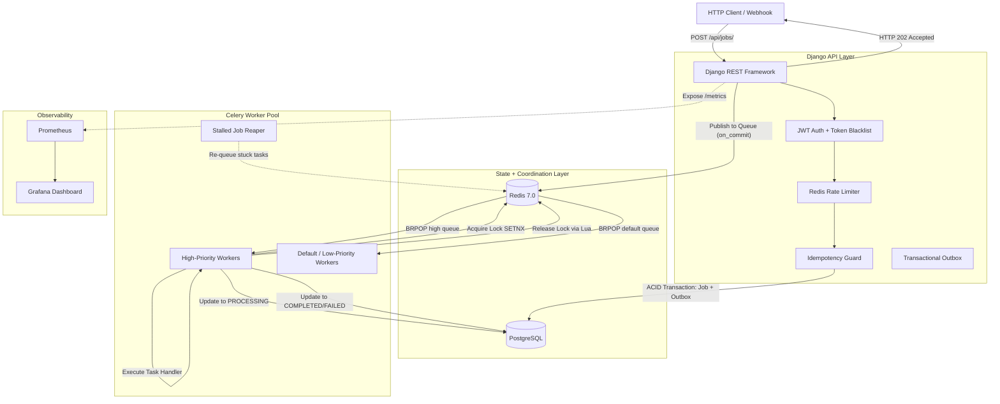

# Distributed Job Queue & Task Processing System

A production-grade, fault-tolerant asynchronous task execution engine and distributed job queue built with **Python, Django REST Framework, Celery, Redis, and PostgreSQL**. 

Features multi-priority scheduling, distributed locking, atomic FSM state transitions, transactional outbox forwarding, stalled job recovery (reaper sweeper), at-least-once delivery guarantees, idempotency deduplication, exponential backoff retries with jitter, Prometheus telemetry, Grafana dashboards, and Docker orchestration.

---

## 📐 Architecture Overview



### Component Responsibilities

| Component | Role |
|:---|:---|
| **PostgreSQL** | Jobs, JobExecutions (audit history), JobResults (outputs), IdempotencyKeys, OutboxMessages |
| **Redis** | Priority message queues, distributed locks (SETNX + Lua), rate limit buckets |
| **API Layer** | JWT auth, rate limiting (100 req/min, 10 jobs/min), idempotency (SHA-256 + unique constraint), Transactional Outbox |
| **Workers** | Multi-priority task execution with `acks_late` for crash recovery, Stalled Job Sweeper |
| **Observability** | Prometheus queue-age & duration histograms, auto-provisioned Grafana telemetry |

---

## 🛠️ Technology Stack

- **Backend Framework:** Python 3.11, Django 4.2+, Django REST Framework (DRF)
- **Database:** PostgreSQL 15 (JSONB payloads, composite indexing, foreign key constraints)
- **Task Queue & Coordination:** Celery 5.3+, Redis 7.0 (Message broker, distributed locks, rate limiting, Beat scheduler)
- **Authentication & Security:** JWT (JSON Web Tokens) with cryptographic rotation and database blacklisting
- **Observability:** Prometheus, `django-prometheus`, Grafana, structured JSON logging with correlation IDs
- **Infrastructure:** Docker, Docker Compose, AWS ECS Fargate, AWS RDS PostgreSQL, AWS ElastiCache
- **Testing & Quality:** Pytest (22 passing unit/integration tests), `pytest-django`, Locust (Load testing)
- **API Documentation:** OpenAPI 3.0 / Swagger UI via `drf-spectacular`

---

## 🚀 Key Distributed Systems Features

### 1. Atomic Job State Machine (FSM)
Jobs transition through a strictly validated finite state machine preventing invalid status mutations:

```
QUEUED → PROCESSING → COMPLETED
                    → RETRYING → PROCESSING (retry)
                    → FAILED
       → CANCELLED
```

### 2. Transactional Outbox Pattern
Job creation and outbox message insertion happen within a single ACID database transaction. A fallback publisher ensures guaranteed task dispatch to Redis even if the web server dies immediately after committing.

### 3. Stalled Job Sweeper (Reaper)
A periodic Celery Beat task identifies jobs stuck in `PROCESSING` whose worker crashed or lost connection, automatically transitioning them to `RETRYING` or `FAILED` state.

### 4. Distributed Locking with TTL & Lua Verification
Prevents duplicate concurrent execution of identical jobs across worker instances:
- **Acquisition:** Redis `SET lock:job:<id> <token> NX PX 120000` (fail-closed in production)
- **Safe Release:** Atomic Lua script verifying token ownership before deleting the key to prevent releasing expired locks acquired by other workers.

### 5. Idempotency Key Deduplication (SHA-256 Hashing)
Clients can supply an `Idempotency-Key: <uuid>` header. The system hashes the request endpoint and payload with SHA-256 and enforces uniqueness at the PostgreSQL database level. Duplicate submissions return the cached HTTP response instantly (`X-Cache-Lookup: HIT-Idempotency`) without spawning redundant jobs.

### 6. Multi-Priority & Dead-Letter Queues
Four distinct queues: `high_priority`, `default_priority`, `low_priority`, and `dead_letter`. Workers perform priority blocking pops (`BRPOP`) draining high-priority tasks first.

### 7. Exponential Backoff with Jitter
Failed jobs retry with randomized exponential backoff to eliminate thundering herd storms on downstream services.

---

## 📦 Quick Start (Local Setup via Docker)

### 1. Clone & Configure Environment
```bash
git clone https://github.com/koushikbobba/distributed-job-queue.git
cd distributed-job-queue
cp .env.example .env
```

### 2. Build & Launch Containers
```bash
docker compose up --build -d
```

### 3. Verify Running Services
```bash
docker compose ps
```

| Service | Port | Description |
| :--- | :--- | :--- |
| **API Server** | `http://localhost:8000` | Django REST Framework API |
| **Swagger UI** | `http://localhost:8000/api/docs/` | Interactive OpenAPI 3 Documentation |
| **Prometheus** | `http://localhost:9090` | Time-series metrics engine |
| **Grafana** | `http://localhost:3000` | Real-time monitoring dashboard (`admin` / `admin`) |
| **PostgreSQL** | `localhost:5432` | Relational Database |
| **Redis** | `localhost:6379` | Cache, Lock engine & Message Broker |

---

## 📡 API Usage & Example Requests

### 1. User Registration & Login
```bash
# Register User
curl -X POST http://localhost:8000/api/auth/register/ \
  -H "Content-Type: application/json" \
  -d '{
    "email": "engineer@example.com",
    "password": "ProductionPassword123!",
    "password_confirm": "ProductionPassword123!"
  }'

# Login to get JWT Bearer Token
curl -X POST http://localhost:8000/api/auth/login/ \
  -H "Content-Type: application/json" \
  -d '{
    "email": "engineer@example.com",
    "password": "ProductionPassword123!"
  }'
```

### 2. Submit a Background Job (with Idempotency Key)
```bash
curl -X POST http://localhost:8000/api/jobs/ \
  -H "Authorization: Bearer <ACCESS_TOKEN>" \
  -H "Content-Type: application/json" \
  -H "Idempotency-Key: txn-7c9b-4401" \
  -d '{
    "job_type": "generate_report",
    "priority": "high",
    "payload": {
      "customer_id": 108,
      "report_type": "monthly"
    },
    "max_retries": 3
  }'
```
**Response (202 Accepted):**
```json
{
  "id": "7b8e722a-cf39-4458-967c-d652ce649987",
  "job_type": "generate_report",
  "priority": "high",
  "payload": { "customer_id": 108, "report_type": "monthly" },
  "max_retries": 3,
  "status": "QUEUED",
  "created_at": "2026-10-09T12:00:00Z"
}
```

### 3. Check Job Status & Execution History
```bash
curl -X GET http://localhost:8000/api/jobs/7b8e722a-cf39-4458-967c-d652ce649987/ \
  -H "Authorization: Bearer <ACCESS_TOKEN>"
```
**Response (200 OK):**
```json
{
  "id": "7b8e722a-cf39-4458-967c-d652ce649987",
  "job_type": "generate_report",
  "status": "COMPLETED",
  "priority": "high",
  "current_retry_count": 0,
  "worker_id": "worker-prod-node-01-a7b4",
  "execution_duration": 1.02,
  "created_at": "2026-10-09T12:00:00Z",
  "started_at": "2026-10-09T12:00:01Z",
  "completed_at": "2026-10-09T12:00:02Z",
  "result": {
    "report_url": "https://s3.amazonaws.com/reports/108_monthly.pdf",
    "customer_id": 108,
    "records_analyzed": 1420
  },
  "executions": [
    {
      "attempt_number": 1,
      "worker_id": "worker-prod-node-01-a7b4",
      "status": "COMPLETED",
      "duration_seconds": 1.02,
      "started_at": "2026-10-09T12:00:01Z",
      "finished_at": "2026-10-09T12:00:02Z"
    }
  ]
}
```

---

## 🧪 Automated Testing

Execute the comprehensive test suite:
```bash
# Run all unit, integration, and reliability tests
pytest
```

---

## 💡 Engineering Challenges & Solutions

### 1. The Post-Commit Message Dispatch & Outbox Pattern
- **Problem:** If a Celery task is dispatched inside a DB transaction, workers query uncommitted rows (`Job.DoesNotExist`). Conversely, if dispatched after commit, server crashes before dispatch lose the message.
- **Solution:** Combined `transaction.on_commit()` fast-path dispatch with a persistent `OutboxMessage` table and background forwarder.

### 2. Cancellation Race Conditions & Optimistic Locking
- **Problem:** When an API user cancels a job while a worker is finishing, the worker could overwrite `CANCELLED` back to `COMPLETED`.
- **Solution:** Enforced database row-level locks (`select_for_update`) and FSM state transition validation (`transition_to`) before marking jobs completed.

### 3. Redis Distributed Lock Fail-Closed Semantics
- **Problem:** Failing open on Redis connection errors causes all workers to execute concurrently during network splits.
- **Solution:** Implemented strict fail-closed distributed locking with token verification via atomic Lua scripts.

### 4. Idempotency Key Deduplication & Payload Tampering
- **Problem:** Replaying an idempotency key with an altered payload can corrupt downstream operations.
- **Solution:** Calculated SHA-256 signatures of `(user_id, path, payload)` and rejected mismatched hashes with HTTP 422.

### 5. Stalled Job Recovery
- **Problem:** Worker container crashes or power loss leave jobs stuck in `PROCESSING` indefinitely.
- **Solution:** Built a periodic Celery Beat reaper (`sweep_stalled_jobs`) that detects expired worker activity and safely recovers tasks.
